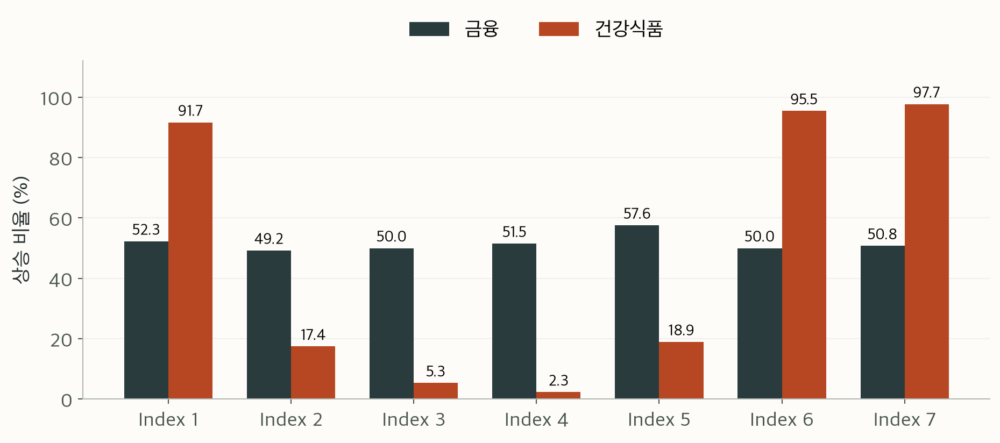

# SKALA 데이터 분석 미니프로젝트

**최종 1등 · 평균 ROC-AUC 0.856276**

KOSPI와 건강식품 지수의 D+3 상승 확률을 예측한 시계열 분류 프로젝트입니다. 두 타깃의 패턴을 따로 분석하고, 금융 변화량과 요일별 수요를 반영하면서 모델을 개선했습니다. 이 저장소에는 그 과정에 대한 회고, 실험 근거, 다시 학습할 수 있는 주요 코드를 담았습니다.

| 최종 결과 | ROC-AUC |
|---|---:|
| 금융 · KOSPI | 0.739926 |
| 건강식품 | 0.972626 |
| **두 타깃 평균** | **0.856276** |

작성자: **김형주 · P071**

## 먼저 읽기

- [회고: 1등까지, 모델보다 먼저 바뀐 질문들](docs/RETROSPECTIVE.md)
- [사용 기법과 모델 구조](docs/METHODS.md)
- [실험 기록과 점수 해석](docs/EXPERIMENTS.md)
- [코드 실행과 재현 범위](docs/REPRODUCIBILITY.md)

## 공식 제출 기록

| 제출 | 제출 시각 (KST) | 금융 AUC | 건강식품 AUC | 평균 AUC | 상태 |
|---|---|---:|---:|---:|---|
| 1회차 | 2026-10-13 13:19:32 | 0.654356 | 0.932959 | 0.793657 | 정상 |
| 2회차 | 2026-10-13 14:43:13 | 0.665596 | 0.943396 | 0.804496 | 정상 |
| 3회차 | 2026-10-13 17:30:06 | 0.705741 | 0.945002 | 0.825371 | 정상 |
| 4회차 | 2026-10-14 09:41:21 | 0.730630 | 0.934163 | 0.832397 | 정상 |

1→4회차 평균 AUC가 **0.793657 → 0.832397 (+0.038740)**로 상승했습니다. 4회차 이후 최종 평균 **0.856276**으로 프로젝트를 마무리했습니다. [제출 기록](evidence/official_submissions.json)

## 어떤 문제였나

금융·검색·쇼핑·날씨·요일 정보를 이용해 두 지수가 D+3에 상승할 확률을 각각 제출하는 과제입니다. 각 타깃의 ROC-AUC와 두 AUC의 평균을 확인했습니다. 과제 전체 평가는 정량 60점과 정성 40점으로 구성되어 있었습니다.

| 데이터 | 규모 |
|---|---|
| 학습 | 924행 · 입력 변수 284개 |
| Public | 100행 |
| Private | 200행 |
| 입력 그룹 | 금융 18 · 검색 51 · 쇼핑 199 · 날씨 15 · 요일 1 |

Public 100행과 Private 앞 100행은 동일한 관측 구간입니다. 두 파일을 별개의 독립 평가 표본으로 취급하지 않았습니다.

## 사용한 기법

금융은 변화량 특성 + 규제 로지스틱 회귀 → 보조 신호 학습 → NCA·KNN 앙상블, 건강식품은 요일·과거 수요 특성 + CatBoost 앙상블로 접근했습니다.

| 구분 | 기법 | 적용 내용 |
|---|---|---|
| 금융 특성 | 차분·스프레드 | 미국 3대 지수 1·2·3일 차분, 환율·금·원유 변화, 금리차·지수 간 차이의 변화 |
| 금융 기준 모델 | RobustScaler + L2 Logistic Regression | 변화량을 스케일링하고 규제로 작은 데이터의 과적합 억제 |
| 금융 보조 신호 | Logistic teacher + Ridge student | 학습 구간의 미래 변화로 얻은 분류 신호를 현재·과거 특성으로 추정 |
| 금융 비선형 모델 | StandardScaler + NCA + KNN | 분류에 유리한 4차원 거리를 학습하고 거리 가중 이웃 90개로 예측 |
| 건강식품 특성 | 요일 범주·EWMA·주간 계절성 | 과거 같은 요일의 수요, 예상 수요와 현재 값의 차이·비율, 7일 변화량 |
| 건강식품 모델 | CatBoost | 원본 입력 모델과 달력 수요 모델을 각각 학습 |
| 앙상블 | 확률·예측 점수 평균 | 금융은 기준·보조·거리 모델을 혼합, 건강식품은 두 CatBoost를 50:50 혼합 |
| 검증 | 시간순 분할 + gap=3 | 과거로 학습하고 이후 구간으로 검증, 마지막 3행의 미성숙 라벨 제외 |

4회차와 점수가 일치하는 저장소의 고정 구성에서는 금융 예측을 **변화량 로지스틱 회귀 25% + 보조 신호 모델 25% + NCA·KNN 50%**로 혼합합니다. 건강식품은 **기본 CatBoost 50% + 달력 수요 CatBoost 50%**입니다.

보조 신호 모델은 학습 때만 미래 변화량을 목표 구성에 사용하며, 추론에는 과거·현재 입력으로 예측한 신호를 넣습니다. NCA 모델의 점수는 학습 구간 기준으로 표준화한 뒤 arctan으로 0~1에 매핑합니다. 이 값은 별도 확률 보정을 거친 상승 확률과 구분합니다.

정확한 특성 계산, 모델 설정과 혼합식은 [사용 기법과 모델 구조](docs/METHODS.md)에 정리했습니다.



요일 인덱스의 실제 월~일 매핑은 확인되지 않았습니다. 위 그림은 학습 구간의 관측 패턴입니다.

## 저장소 구성

```text
README.md
requirements.txt
docs/
  RETROSPECTIVE.md       # 문제를 풀어간 과정과 회고
  METHODS.md             # 특성·알고리즘·앙상블 구조
  EXPERIMENTS.md         # 공식 제출·개발 검증·로컬 평가 구분
  REPRODUCIBILITY.md     # 실행 방법과 검증 범위
assets/                 # 학습 데이터 분석 그림
evidence/               # 점수·데이터 프로파일·과거 실험 기록
src/
  train_selected.py     # 고정된 과거 후보 재학습
  predict_submission.py # 예측 및 동결 예측과의 비교
  recipe.json           # 재현할 모델 구성
  clean_causal*.py      # 과거·현재 입력 기반 모델링
  test_*.py             # 합성 데이터 기반 누수 방지 검사
  expected/             # 과거 후보의 재현 비교용 예측
  data/README.md        # 데이터 배치 안내
```

## 실행

Python 3.12 환경을 사용합니다. 제공받은 원본 데이터 5개를 `src/data/`에 준비한 뒤 실행합니다. 데이터는 저장소에 포함하지 않았습니다.

```sh
python3.12 -m venv .venv
source .venv/bin/activate
python -m pip install -r requirements.txt
cd src
python -m unittest test_clean_causal test_clean_causal96_stage2
python train_selected.py
python predict_submission.py --model-dir models_retrained
```

**실행 예제는 4회차와 점수가 일치하는 stage2 고정 구성(평균 AUC 0.832397)을 재현합니다.** 재학습한 예측은 `src/expected/`와 비교합니다.

## 기록을 읽을 때

공식 제출 결과, 개발 검증, 정답 공개 후 로컬 비교는 각각 구분했습니다. 탐색 중 미래 관측 입력을 사용한 고득점 실험은 나중에 제외했으며, 그 점수를 최종 성과로 사용하지 않았습니다. 상세한 판단과 배운 점은 [회고](docs/RETROSPECTIVE.md)에 남겼습니다.

원본 강의자료와 제공 데이터, 평가 정답, 학습 모델 파일은 이 저장소에 포함하지 않았습니다.
