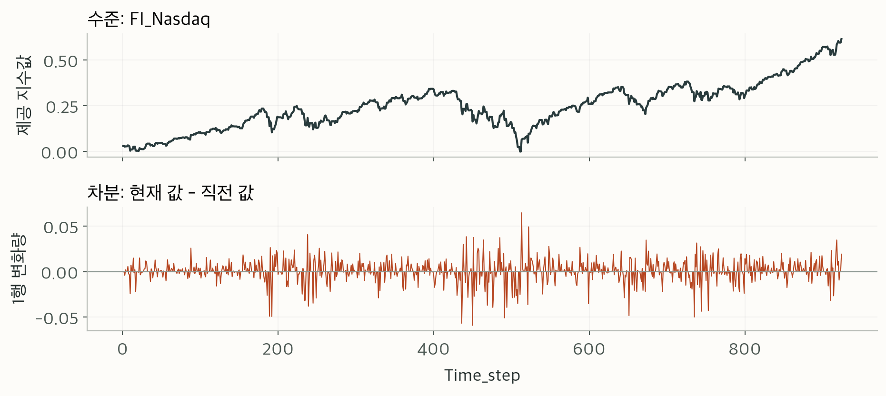

# 1등까지, 모델보다 먼저 바뀐 질문들

이번 SKALA 데이터 분석 미니프로젝트는 최종 1등으로 마무리했다. 금융 AUC는 0.739926, 건강식품 AUC는 0.972626, 평균은 0.856276이었다.

결과만 적으면 간단하지만, 실험 기록을 다시 펼쳐 보면 곧게 올라가는 과정은 아니었다. 새로운 모델을 넣어도 점수가 그대로인 때가 있었고, 높은 점수를 얻고도 그 결과를 제외해야 했던 때가 있었다. 이 글에는 그 사이에 접근이 어떻게 바뀌었는지를 남긴다.

최종 순위와 세 점수는 참여자가 전달한 결과를 기준으로 한다. 아래의 중간 실험 점수는 당시 파일에 남은 기록이며, 최종 제출 모델과 동일하다고 단정하지 않는다.

## 1. 같은 데이터인데 두 타깃의 난도가 달랐다

과제는 D+3의 KOSPI와 건강식품 지수가 상승할 확률을 예측하는 일이었다. 학습 데이터는 924행, 입력은 284개였다. 금융뿐 아니라 검색어, 쇼핑, 날씨와 요일이 함께 들어 있었다.

처음 비교한 CatBoost의 시간순 검증에서 금융 AUC는 약 0.4751, 건강식품은 약 0.9575였다. 평균만 보면 이 차이를 놓치기 쉽다. 건강식품에서 이미 높은 점수를 얻는 동안 금융은 상승과 하락을 제대로 구별하지 못하고 있었다.

여기서 두 타깃을 나눠 접근하기 시작했다. 건강식품은 어떤 반복 패턴이 있는지, 금융은 지금의 입력 표현으로 방향을 구별할 수 있는지부터 확인했다.

## 2. 건강식품에서는 요일이 먼저 보였다

요일 인덱스별 상승 비율을 보면 건강식품은 1·6·7에서 약 91.7%·95.5%·97.7%였고, 3·4에서는 약 5.3%·2.3%였다. 금융에서는 이만큼 뚜렷한 차이가 없었다.

요일을 숫자 하나로 넣는 방식과 범주로 다루는 방식을 비교하고, 과거 같은 요일의 수요를 활용하는 특성도 만들었다. 예측하려는 D+3의 요일은 계산할 수 있으므로, 그 요일에 해당하는 과거 수요로 예상 수준을 구하는 접근이었다.

이때 경계를 분명히 해야 했다. 미래의 요일은 알 수 있지만, 미래의 실제 쇼핑 지수는 알 수 없다. 과거 수요로 추정한 값과 실제 D+3 관측값은 전혀 다른 입력이다.

기존 CatBoost와 요일별 수요 모델을 50:50으로 혼합한 후보는 건강식품 개발 검증에서 150행 구간 평균 0.964922→0.969614, 100행 구간 평균 0.964023→0.967728을 기록했다. 단일 모델을 바꾸기보다 두 모델의 예측을 섞는 구성이 두 검증 기준에서 나았다. 이것이 곧 최종 점수의 개선폭을 뜻하는 것은 아니다.

## 3. 금융에서는 수준보다 변화량을 봤다

금융은 모델 종류를 늘리는 것만으로 해결되지 않았다. 입력은 실습용으로 표준화된 값이었고, 원시 가격을 다루듯 변화율을 바로 계산하는 것도 조심해야 했다.

미국 주요 지수의 1일·3일 차분, 환율·금·원유의 차분을 만들고 규제가 있는 로지스틱 회귀로 비교했다. 초기 금융 개발 AUC 0.5470에서 변화량 모델은 0.6111로 올라갔다. 이후 금리차와 지수 간 차이, 일부 검색어의 변화량 등을 더한 구성은 약 0.6382를 기록했다.

이 단계에서 얻은 교훈은 입력을 어떻게 표현하느냐를 먼저 살펴야 한다는 것이었다. 이번 데이터에서는 금융의 최근 변화를 작은 모델에 넣는 방식이 초기 트리 모델보다 나았다.

공식 제출 기록에서도 변화가 이어졌다.

| 회차 | 금융 AUC | 건강식품 AUC | 평균 AUC |
|---|---:|---:|---:|
| 1회차 | 0.654356 | 0.932959 | 0.793657 |
| 2회차 | 0.665596 | 0.943396 | 0.804496 |
| 3회차 | 0.705741 | 0.945002 | 0.825371 |
| 4회차 | 0.730630 | 0.934163 | 0.832397 |

1회차에서 4회차까지 평균은 0.038740 올랐다. 금융은 네 번의 제출에서 계속 개선됐지만, 건강식품은 3회차보다 4회차에서 낮아졌다. 두 타깃이 매번 함께 좋아진 것은 아니었다. 4회차에서는 금융 개선폭이 건강식품 하락폭보다 커 평균 점수가 상승했다.

이 표는 참여자가 제공한 공식 제출 이력이다. 최종 1등 평균 0.856276은 별도로 전달받은 결과이므로, 4회차 점수와 혼동하지 않도록 구분했다.

## 4. 더 복잡한 방법이 늘 답은 아니었다

이후에는 금융의 보조 변화량 예측, 거리 학습인 NCA와 KNN, 스태킹, 확률 보정, 쌍별 순위 학습, PCA 등을 비교했다. 보조 모델은 학습 구간 안에서 미래 변화량을 목표로 학습하되, 실제 예측에는 과거·현재 입력으로 추정한 변화량을 넣었다.

채택하지 않은 실험도 많았다. 최근 구간만 학습한 NCA 혼합은 150행 기준에서 떨어졌고, 쌍별 순위 학습과 PCA 조합도 비교 기준을 함께 개선하지 못했다. 건강식품에 금융과 같은 거리 학습을 적용해도 기존 후보보다 나아지지 않았다.

새 방법이라는 이유로 바꾸지 않았다. 이미 여러 번 살펴본 검증 구간이라는 한계는 있었지만, 적어도 한 구간의 최고점만 보고 결정을 내리지 않으려 했다.

## 5. 높은 점수를 얻고도 제외한 실험

탐색 기록에는 로컬 Public 평균 0.960458도 있다. 당시 기록된 1등 기준 0.958450을 넘는 값이었다. 하지만 이후 점검에서 실제 D+1~D+3 금융 입력과 D+3 쇼핑 입력이 사용됐고, 평가 정답에 따른 후보 선택도 포함됐다는 문제가 확인됐다.

D일에 예측해야 한다면 그 이후에 관측되는 값은 사용할 수 없다. 모델을 train.csv로만 학습했더라도 추론 입력에 미래가 들어가면 문제가 남는다. 이 고득점 실험은 제출 추천에서 제외했다.

그 뒤에는 미래 행을 잘라내거나 바꿔도 과거 예측이 같은지, Target 열을 바꿔도 특성이 그대로인지, 마지막 3행의 미성숙 라벨이 학습에 영향을 주지 않는지를 검사했다.

이 과정은 회고에서 빼고 싶지 않은 부분이다. 점수와 함께 그 점수를 얻은 조건을 남겨야 나중에 다시 읽었을 때도 설명할 수 있다. 제외한 0.960458은 최종 1등 점수 0.856276과 별개의 실험이다.

## 6. 마지막에는 제출과 재현을 챙겼다

모델 선택 이후에도 할 일이 남아 있었다. 샘플과 같은 열 이름과 행 순서를 맞추고, 확률이 0~1 안의 유한한 값인지 확인했다. 입력·코드·모델·출력의 해시와 설정을 남기고, 저장 모델 및 고정 설정 재학습으로 예측을 재현했다.

원래 작업 폴더에는 실험이 많이 쌓여 있었다. 이 저장소에서는 읽는 사람이 흐름을 따라갈 수 있도록 회고와 실험 요약을 먼저 두고, 고정된 과거 후보의 학습·예측 코드만 추렸다.

다만 최종 결과를 만든 정확한 제출 파일과 모델 설정은 현재 보관 기록에서 연결되지 않는다. 포함한 stage2 코드의 로컬 Public 평균은 0.832397이며, 공식 4회차의 세 점수와 일치한다. 업로드 파일의 해시까지 확인한 것은 아니다. 최종 평균 0.856276을 그대로 재현한다고 쓰지 않은 이유다.

## 다음에 다시 한다면

처음부터 최종 확인용 구간을 따로 남기고, 개발 구간을 반복해서 본 횟수도 관리하겠다. 평가 정답을 확인한 뒤의 실험은 별도 기록으로 두어 독립 성능처럼 읽히지 않게 하겠다.

제출 이력도 더 일찍 정리할 필요가 있었다. 파일명만으로 어느 설정의 결과인지 추측하지 않도록, 제출 CSV의 해시·학습 설정·공식 점수·순위를 한 묶음으로 남기겠다. 그래야 최종 성과와 실행 코드를 바로 연결할 수 있다.

이번 과정에서 가장 오래 남을 것은 두 타깃을 따로 보는 습관이다. 건강식품의 요일 패턴과 금융의 변화량은 같은 표 안에 있었지만 필요한 접근이 달랐다. 다음 프로젝트에서도 모델을 늘리기 전에, 지금 무엇을 예측하고 있고 그 시점에 어떤 정보를 실제로 알 수 있는지부터 확인하려 한다.
